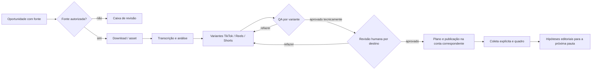

# Escritórios e agentes para operação de canais

Data: 11/10/2026. Estado: arquitetura proposta, sem execução automática de agentes nesta entrega.

## Objetivo e decisões

O usuário entra em um **escritório** e encontra o trabalho de um canal: oportunidades, lives, cortes, calendário, publicações, desempenho e conversas entre agentes. Personagens em pixel art representam papéis e estados reais. Cada ação na cena abre um cartão com evidência, artefato, responsável e próxima decisão. O escritório não é uma animação separada da aplicação.

**Decisão do usuário:** um escritório corresponde a uma marca/editoria e pode conter até uma conta TikTok, uma conta Instagram e um canal YouTube inicialmente. Shorts é um formato publicado no canal YouTube, não uma conta separada. Cada conexão tem identidade, permissões, preset de vídeo, calendário e métricas próprios. Um escritório pode começar só com TikTok; contas desconectadas não recebem publicação. Não criar limite artificial para número de escritórios no modo local; limitar tarefas simultâneas e uso de recursos.

**Fonte da verdade:** SQLite e artefatos versionados locais. A interface projeta esse estado. Uma fala de personagem é uma visualização de evento persistido, não uma decisão tomada só no navegador. Avatares não são identidades externas nem executores de GPU independentes.

## O que já existe e o que falta

| Atual | Aproveitamento | Lacuna |
| --- | --- | --- |
| `EditorialProfile`, escopo no React, `Project.profile_id` | Entrada no escritório e organização de lives | Nomear Office explicitamente; contas por plataforma; políticas e orçamento do escritório |
| TikTok OAuth, vínculo, agenda, publicações e snapshots | Primeiro conector real | Adaptadores Instagram/YouTube separados; matriz de capacidades por conta e permissão |
| `Job` de download/análise/exportação e worker | Trabalho pesado e progresso | Pipeline editorial de tarefas, dependências, handoffs, histórico de decisões e recuperação |
| Candidato, revisão, versões MP4, legenda, feedback | Materiais da edição | Checagem automática de qualidade com relatório; aprovação humana vinculada ao hash da versão |
| Resultado/publicação | Quadro de desempenho | Comparação por plataforma/idade, atribuição ao arquivo publicado e evidência de comentário quando autorizada |

O modelo atual `EditorialProfile.account_open_id` suporta uma conta TikTok. A ampliação para várias plataformas exige uma entidade de vínculo por `(office_id, platform, external_account_id)`; não adicionar colunas de Instagram/YouTube ao modelo TikTok. Lives antigas sem perfil ficam em uma caixa de entrada para associação manual, preservando IDs e histórico.

## Modelo de dados proposto

- **Office**: `office_id`, nome, nicho, tom, idioma, timezone, objetivos, política de direitos, orçamento diário, versão de configuração, status. Preferências editoriais pertencem ao escritório; uma mudança não altera exportações históricas.
- **ChannelConnection**: `connection_id`, `office_id`, plataforma, conta externa, escopos concedidos, capacidades ativas, estado da autorização. Restrição inicial: uma conexão ativa por plataforma em cada escritório. Tokens ficam em armazenamento privado, referenciados por ID; não entram em eventos, logs ou prompts.
- **PlatformPreset**: `office_id`, `platform`, versão, faixa preferida de duração, aspecto, enquadramento, localização/estilo de legenda, cabeçalho, marca, tom do texto, hashtags/tags, política de silêncio e critérios de QA. Cada campo pode ser alterado no escritório e sobrescrito no corte; presets novos não modificam publicações antigas.
- **SourceOpportunity**: URL/canal/tema, origem, data de observação, licença ou autorização declarada, indícios públicos com proveniência, validade e motivo de interesse. “Em alta” é hipótese datada, não fato inferido de views isoladas.
- **SourceAsset / Live**: reaproveita `MediaAsset` e `Project`; liga à oportunidade e ao escritório. Não duplicar a mesma mídia para cada plataforma.
- **ClipPackage**: acontecimento selecionado na live, evidências e contexto comum; não presume que um único intervalo sirva às três plataformas.
- **PlatformVariant**: `clip_package_id`, `platform`, `connection_id`, intervalo próprio no vídeo original, revisão, preset/versionamento, MP4 selecionado por hash, transcrição corrigida, legenda visual, título na tela e texto de post. TikTok, Reels e Shorts podem ter abertura, duração e edição diferentes; cada variante tem estado editorial e aprovação próprios.
- **WorkItem**: tipo, escritório, entrada versionada, responsável lógico, dependências, prioridade, prazo, estado, contador de tentativas, `idempotency_key`, recurso necessário (`cpu`, `gpu`, `external_api`), motivo de bloqueio.
- **AgentRun / Handoff**: agente e versão de prompt/modelo/regras, insumos referenciados, saída estruturada, evidências, custo/tempo, limitações e destinatário. Handoff não é texto solto: aponta para IDs e hashes.
- **OfficeEvent**: evento imutável para timeline/conversa, `office_id`, `work_item_id`, ator, tipo, horário, payload redigido; uma tabela de outbox publica eventos após a transação do estado.
- **ReviewDecision**: revisor, `platform_variant_id`, versão/hash do MP4 e versão do texto de publicação, critérios, decisão `approve/rework/reject`, observações e horário. Alterar MP4, limites, legenda, título ou texto invalida a aprovação daquela variante, sem invalidar automaticamente as outras.
- **PublicationPlan / Publication / MetricSnapshot**: plano por conta e plataforma; publicação aponta para o export exato; snapshot tem fonte, horário e idade da postagem, inclusive dado ausente distinto de zero.

Contratos novos serão versionados com exemplos e revisão de API, worker e frontend. Horários de corte continuam em segundos da mídia original, início inclusivo e fim exclusivo. `office_id` e `connection_id` atravessam todas as consultas e jobs; o servidor verifica pertencimento, sem confiar em ID enviado pelo cliente.

### Presets editoriais iniciais

Estes números são **preferências configuráveis do produto para testar**, não limites oficiais nem garantia de alcance. A escolha do usuário é começar com Shorts mais curtos. O motor deve procurar começo, contexto e final dentro da faixa; se a fala não fechar, oferece outra variante ou sinaliza que não há corte adequado, em vez de truncar.

| Destino | Faixa inicial sugerida | Decisão editorial padrão |
| --- | --- | --- |
| TikTok | 25–60 s | Gancho e contexto suficientes; estilo visual do perfil |
| Instagram Reels | 20–45 s | Texto na tela e área segura conferidos para o layout da conta |
| YouTube Shorts | 15–30 s | Uma ideia ou reação fechada; sem introdução longa |

Um único download e uma única transcrição alimentam as três buscas. O editor pode criar, por exemplo, TikTok 42 s, Reels 31 s e Shorts 22 s **do mesmo acontecimento**, cada um com `start_s/end_s` próprios relativos à live original. Não recortar mecanicamente o início/fim da versão TikTok para produzir Shorts. Render, thumbnail, título, descrição, agenda, QA, revisão humana e métricas são individuais por plataforma. O painel oferece “gerar para todas as contas conectadas” e seleção por destino; alterações em lote mostram a prévia de cada variante.

## Equipe do escritório

| Personagem | Entrega verificável | Dependências e limites |
| --- | --- | --- |
| Coordenador | Abre tarefas, confere dependências, registra handoffs e bloqueios | Não edita mídia nem publica por conta própria |
| Minerador de pautas | Lista oportunidades com URL, data, contexto, origem e justificativa | Fontes permitidas; sem scraping agressivo nem declarar viralidade futura |
| Estrategista/roteirista | Brief com público, ângulo, gancho, sequência e chamada; para cortes, propõe estrutura fiel ao material | Não inventa fala nem contexto ausente; vídeo original roteirizado é fluxo separado |
| Ingestão | Valida fonte/autorização, baixa e registra asset por hash | Usa adaptadores existentes; não baixa antes do gatilho autorizado |
| Analista de cena | Transcrição, evidência visual/áudio, regiões e limitações | Uma tarefa pesada de GPU por vez; proveniência por intervalo |
| Editor | Limites, formato, enquadramento, legendas, cabeçalho, versões MP4 | Reaproveita exportador; proposta não substitui versão aprovada |
| Revisor técnico | Relatório sobre início compreensível, fim de fala, ASR, áudio, enquadramento, legenda, marca e arquivo | Bloqueia falhas objetivas; incerteza segue à revisão humana |
| Publicador | Monta texto, hashtags, conta, privacidade e agenda por plataforma | Só executa após aprovação humana para o hash exato e consentimento da ação |
| Analista de resultados | Compara publicações equivalentes e resume comentários autorizados | Coleta externa somente por ação explícita; ausência ≠ zero; feedback não treina sozinho |

Começar com **três agentes ativos**: coordenador, editor/revisor e analista de resultados. Minerador/roteirista entram depois de existir fonte confiável e avaliação editorial. Papéis lógicos não exigem processos simultâneos nem um modelo diferente para cada personagem. O mesmo executor pode cumprir papéis sequencialmente, sob contrato próprio.

## Fluxo e conversa

Estados de `WorkItem`: `proposed → ready → leased → running → submitted → accepted`, com saídas `needs_review`, `blocked`, `failed`, `cancelled`; `accepted` não significa publicado. Cada passagem grava mensagem visível: “Editor entregou export X; revisor apontou legenda aos 00:12; voltou para edição”. A mensagem contém links para artefatos e versões. Um agente não altera o trabalho de outro silenciosamente; o coordenador aceita o handoff e cria a próxima tarefa na mesma transação. Lease, heartbeat, retry limitado e chave de idempotência evitam loop e duplicação; publicação incerta nunca é repetida automaticamente.

O revisor usa uma ficha reproduzível: **gancho (0–3 s), contexto autossuficiente, progressão, conclusão, precisão da fala, áudio, enquadramento, legibilidade e conformidade de plataforma**. Itens medidos, interpretação e hipótese aparecem separados. Falhas determinísticas (arquivo inválido, silêncio, legenda fora de tempo, rosto cortado conforme detector) podem bloquear; juízo de interesse é recomendação com evidência e passa ao humano.

## Sala visual

- Tela de entrada: cartões de escritórios com avatar/marca, contas conectadas, trabalhos ativos e alertas. Trocar escritório é explícito, como hoje se troca perfil.
- Planta 2D em pixel art como navegação: mesa do minerador (oportunidades), sala de roteiro (briefs), ilha de edição (lives e versões), mesa de QA (pendências), sua mesa (aprovar/refazer), calendário (agendas), quadro (métricas). Personagem muda entre livre/trabalhando/aguardando/bloqueado apenas quando o estado real muda.
- Na ilha de edição, cada acontecimento abre três trilhas independentes (TikTok, Reels, Shorts) com preset, duração, miniatura, status e prévia. A sua mesa recebe três aprovações separadas; publicar em um destino não publica nos outros.
- Cada estação também tem lista acessível com filtros, pesquisa, ações e detalhes; animação pode ser desligada, e layout móvel usa cartões. O quadro mostra período, plataforma, conta, amostra, idade dos posts, fonte, última coleta e “indisponível” para métrica ausente. Views e score interno não aparecem como probabilidade de viralizar.
- Conversa tem timeline do escritório e fios por tarefa. Resumos podem ser gerados, mas logs técnicos, URLs, transcrição e saídas de modelo entram como **dados não confiáveis**, nunca instruções para agentes ou ferramentas.

## Integrações e ações externas

TikTok é o primeiro conector porque já há OAuth, vínculo, postagem e métricas no projeto. A API de postagem exige autorização e consentimento explícito antes do envio; cliente não auditado pode ficar restrito a publicação privada. Instagram requer conta profissional e escopos conforme o método de login; YouTube usa autorização OAuth para upload e analytics. Cada conector anuncia capacidades concretas (`read_own_posts`, `publish_video`, `read_comments`, `read_metrics`) e estados `available / missing_scope / review_required / unsupported`, sem liberar um botão funcional só por existir link de perfil.

Coleta de métricas e comentários acontece por ação explícita do administrador ou operação autorizada específica; cadastro e GET não coletam. Comentários recebem origem e vínculo ao post, são resumidos com proteção contra prompt injection e não geram resposta pública automaticamente. Publicação, resposta a comentário, exclusão externa e qualquer envio para rede exigem escopo, conta correta e ação/consentimento previstos. A aprovação humana final é obrigatória na primeira versão do escritório.

## Recursos, isolamento e segurança

- SQLite com tabelas e índices por escritório no modo local; outbox transacional para eventos. Não iniciar com microserviços, barramento distribuído ou nove modelos residentes. Migrar storage somente com backup, migração reversível e testes de isolamento.
- Worker existente continua dono das mídias. Coordenador agenda **um executor pesado de GPU por vez**, com reserva explícita; tarefas leves podem usar CPU separadamente. Limites por escritório: jobs ativos, minutos de mídia, armazenamento, chamadas externas e orçamento de inferência; mostrar uso e fila no painel.
- Credenciais ficam fora do Git e dos prompts. Acesso ao escritório e às contas é verificado no backend, inclusive downloads e thumbnails; se virar SaaS multiusuário, introduzir autenticação, papéis (`owner`, `editor`, `viewer`) e tenant isolation antes da exposição pública. O isolamento atual de perfis é organização de UI, não segurança multiusuário.
- Dados de tendência, vídeo, áudio, comentários e respostas de modelo são entradas não confiáveis. Ferramentas recebem parâmetros tipados e allowlist; nada executa comandos extraídos do conteúdo. Direitos de uso da fonte e permissões de publicação ficam explícitos. Auditoria guarda ações externas e quem as aprovou.

## Construção em ondas e aceite

| Onda | Entrega | Dependência | Aceite observável |
| --- | --- | --- | --- |
| E0 Fundação | Contratos `Office`, `ChannelConnection`, `PlatformPreset`, `PlatformVariant`, `WorkItem`, `AgentRun`, `OfficeEvent`, `ReviewDecision`; migração dos perfis sem perder lives | ADR 0004; backup | Dados antigos visíveis; uma conta por plataforma; consultas cross-office rejeitadas; exemplos/OpenAPI/testes |
| E1 Fluxo real | Coordenador e revisor técnico sobre jobs existentes; variantes com presets TikTok/Reels/Shorts; timeline; revisão humana ligada ao hash de cada destino | E0 | Uma live gera variantes independentes, Shorts mais curto quando há fechamento; refazer invalida só sua aprovação; reinício não duplica |
| E2 Interface | Escritório 2D e estações conectadas às APIs; lista acessível e painel móvel | E1 | Estado visual corresponde ao banco após atualização; navegação por teclado; job bloqueado explicado |
| E3 Planejamento | Minerador de oportunidades + briefs fiéis à fonte, primeiro por URL aprovada e depois fontes autorizadas | E1 e fonte/licença | Oportunidade tem URL/data/proveniência; não inicia download silencioso; revisão cega de briefs |
| E4 Multiplataforma | Matriz de conectores; Instagram e YouTube em ondas separadas; publicação da variante aprovada | E0/E1, app/scopes externos | Conta isolada; rascunho, upload, falha e métricas testados conforme API; nenhum post sem aprovação específica |
| E5 Inteligência do canal | Quadro de métricas/comentários e propostas de melhoria por escritório | E4 ou TikTok isolado | Snapshots comparáveis por idade; fonte/ausência explícita; feedback não aciona treino |

**Trilho de qualidade:** antes de promover seleção, testar top 5 em lives reservadas com avaliação cega de contexto, início, fim e utilidade; depois comparar posts da mesma conta/plataforma com idade e edição semelhantes. Uma melhora visual do escritório não comprova melhora editorial.

## Delegação para construir

O coordenador é o único dono por rodada de `shared/`, migrações, OpenAPI, dependências e lockfiles. Antes de abrir subagentes, entregar para cada um: tarefa, entradas, saída, dependências, área exclusiva, testes e aceite. Lotes sugeridos após E0: (1) `services/office_workflow.py` + testes de transição; (2) `frontend/src/Office*` e CSS com API mockada; (3) `quality/review.py` + fixtures de vídeo e áudio. Integrar nessa ordem: contratos → workflow → QA → API → UI → conectores. Cada agente deixa handoff em `docs/handoffs/`; o coordenador verifica o conjunto e atualiza `docs/STATUS.md`. Checkout é compartilhado, sem isolamento automático; não reverter arquivos de outro executor.

## Fontes de capacidades externas

- [TikTok Direct Post](https://developers.tiktok.com/docs/en/content-posting-api-reference-direct-post): consentimento/escopo e restrição de cliente não auditado.
- [Meta Instagram API oficial](https://www.postman.com/meta/instagram/documentation/6yqw8pt/instagram-api): contas profissionais, publicação e permissões.
- [YouTube videos.insert](https://developers.google.com/youtube/v3/docs/videos/insert) e [YouTube Analytics/Reporting](https://developers.google.com/youtube/reporting): upload e análise requerem autorização.

Estas fontes descrevem capacidades e condições gerais na data acima; escopos, análise de app, limites e disponibilidade devem ser verificados de novo ao implementar cada conector.
